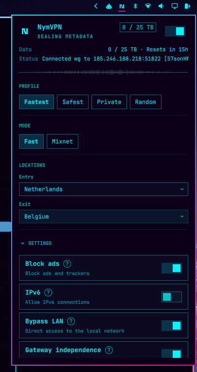
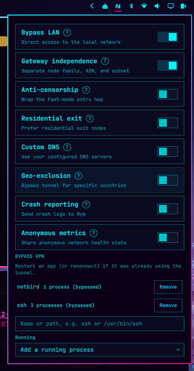
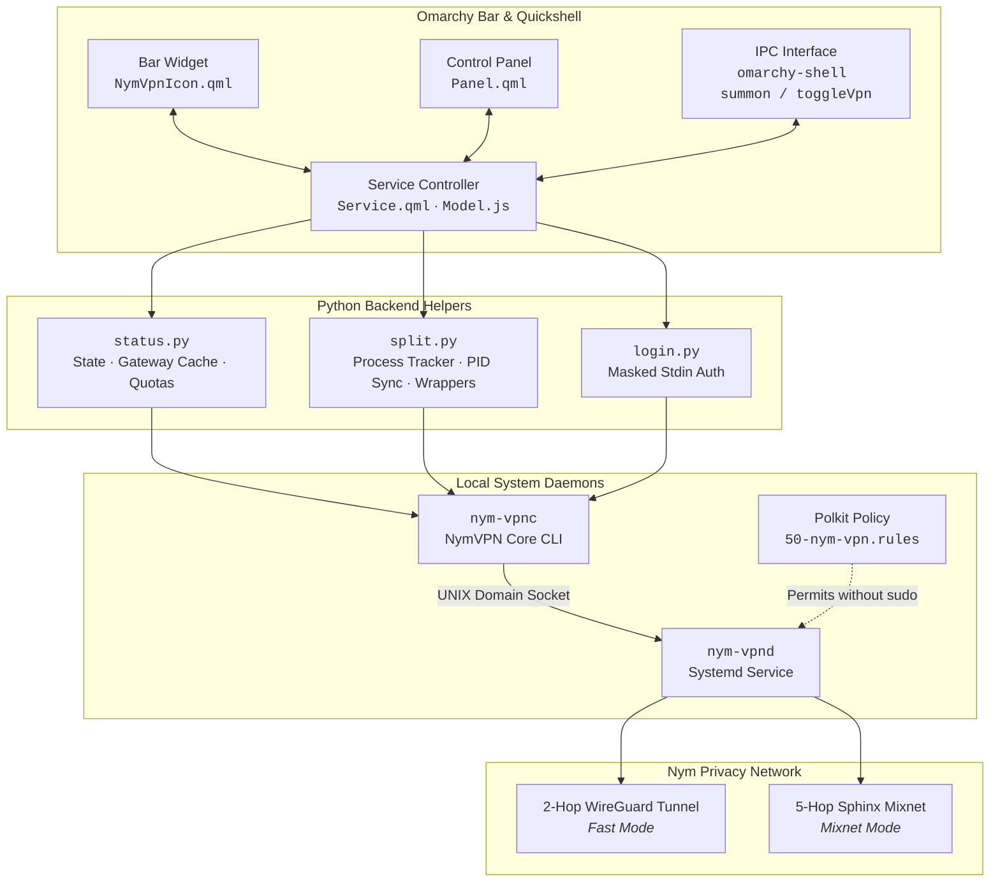

<div align="center">

# Omarchy NymVPN Plugin

<p align="center">
  <strong>Native bar widget and control panel for <a href="https://nym.com/">NymVPN</a> on <a href="https://omarchy.org/">Omarchy Linux</a></strong>
</p>

<p align="center">
  <a href="https://github.com/pepijn-blom/omarchy-plugin-nymvpn/blob/master/LICENSE"></a>
  <a href="https://omarchy.org/"></a>
  <a href="https://nym.com/"></a>
  <a href="https://quickshell.outfoxxed.me/"></a>
  <a href="tests/"></a>
</p>

<p align="center">
  Toggle tunnels, switch routing modes, pick entry/exit gateways, monitor fair-use quotas in real time,<br>
  and manage process-level split tunneling directly from your Omarchy status bar.
</p>

---

### Interface Overview

| Active Tunnel & Quota Monitor | Advanced Privacy & Process Bypass |
| :---: | :---: |
|  |  |
| <sub><i>Connected WireGuard state, live data allowance meter, profile presets, and routing hops.</i></sub> | <sub><i>Granular privacy controls, daemon reconciliations, and split-tunnel bypass managers.</i></sub> |

</div>

<br>

> [!NOTE]
> This is an unofficial third-party Quickshell plugin (`pepijn-blom.nymvpn`). It communicates with the `nym-vpnc` command-line client, which interfaces via Polkit-secured RPC to the local `nym-vpnd` system daemon. It does not install NymVPN itself and is not officially affiliated with Nym.

---

## ✨ Features

- 🟢 **Live Bar Indicator**: Crisp Nym **N** glyph with animated traffic tracers, stateful color pulsing, and warning badges.
- ⚡ **Dual Routing Architectures**: Instantly switch between **Fast** (2-hop WireGuard) and **Mixnet** (5-hop Sphinx encrypted packet mixing).
- 🌍 **Searchable Gateway Pickers**: Dynamic entry and exit country selection with local caching.
- 📊 **Quota & Fair-Use Telemetry**: Live bandwidth tracker (`used / limit`) with countdown reset timers and soundwave visualizer.
- 🔀 **Advanced Split Tunneling (Bypass VPN)**: Exclude running or future processes by binary name or absolute path (e.g. `ssh` or `/usr/bin/ssh`) backed by dynamic `nym-exclude` wrappers.
- 🛡️ **Comprehensive Privacy Controls**:
  - Ad & tracker blocker
  - IPv6 leak mitigation
  - Local network (LAN) bypass
  - Gateway independence (disjoint node families, ASNs, subnets)
  - Anti-censorship protocol wrapping
  - Residential exit node preference
  - Custom DNS configuration
  - Daemon-enforced Geo-exclusion (`CN` / `RU`)
- 🔒 **Privacy-First Sign-in**: The recovery phrase is entered in a masked field and sent to `login.py` on stdin. `nym-vpnc` still requires it as an argument, so the helper overwrites that argument immediately and kills the sign-in process if the phrase stays visible.
- ⌨️ **Vim-Inspired Keyboard Workflow**: Fully navigable via keyboard without touching your mouse.
- 🔌 **Omarchy IPC API**: Full automation support via `omarchy-shell` commands.

---

## 🎨 Bar Icon States

The bar widget uses the official NymVPN **N** mark drawn as crisp geometric glyphs that remain razor-sharp at high-DPI bar scales.

| State | Visual Indicator | Meaning |
| :--- | :--- | :--- |
| **Connected (Fast)** | Solid cyan **N** with diagonal packet dot | WireGuard 2-hop tunnel established and active |
| **Connected (Mixnet)** | Solid cyan **N** with bi-directional dots | 5-hop Mixnet tunnel active with cover traffic tracer |
| **Connecting** | Rhythmic pulse animation | Daemon establishing handshake and routing paths |
| **Disconnected** | Dimmed monochrome glyph | Tunnel inactive; traffic bypasses VPN |
| **Warning / Action Needed** | Amber badge indicator | Daemon unreachable or no account credentials stored |

---

## ⌨️ Controls & Shortcuts

### Mouse Gestures

| Action | Result |
| :--- | :--- |
| **Left Click** | Open / close the interactive control panel |
| **Right Click** | Instantly toggle tunnel connection (or focus sign-in if unauthenticated) |
| **Middle Click** | Refresh daemon state, gateway caches, and bandwidth quotas |

### Panel Keyboard Shortcuts

| Keybinding | Action |
| :--- | :--- |
| <kbd>j</kbd> / <kbd>k</kbd> or <kbd>↓</kbd> / <kbd>↑</kbd> | Move navigation focus up and down |
| <kbd>Enter</kbd> / <kbd>Space</kbd> | Toggle focused setting or activate control |
| <kbd>t</kbd> | Toggle VPN connection state |
| <kbd>r</kbd> | Refresh daemon status and gateway catalog |
| <kbd>x</kbd> / <kbd>d</kbd> | Force disconnect (`nym-vpnc disconnect --wait`) |
| <kbd>Esc</kbd> | Dismiss panel (or clear recovery phrase field when focused) |
| <kbd>Enter</kbd> (in bypass field) | Exclude process by executable name or path |

---

## 🏗️ Architecture



---

## 📦 Requirements

- **Linux Platform**: Omarchy Linux with Quickshell plugin support.
- **`nym-vpnc`**: CLI client from `nym-vpn-core` on system `PATH` (separate binary from `nym-vpn-app`).
- **`nym-vpnd`**: Running system daemon (typically enabled via systemd: `sudo systemctl start nym-vpnd`).
- **Polkit Authorization**: Rule allowing socket communication without interactive root password prompts.
- **Nym Account**: Valid account on device (sign in directly from the panel using your recovery phrase).

### Polkit Configuration

`nym-vpnd` listens on a local Unix socket managed by Polkit (`com.nymvpn.vpnd.unix-access`). To query status and toggle connections seamlessly, configure `/etc/polkit-1/rules.d/50-nym-vpn.rules`:

```javascript
polkit.addRule(function(action, subject) {
    if (action.id === "com.nymvpn.vpnd.unix-access" &&
        subject.local && subject.active &&
        (subject.isInGroup("wheel") || subject.isInGroup("nym-vpn"))) {
        return polkit.Result.YES;
    }
});
```

> [!TIP]
> A reference policy is included in `polkit/50-nym-vpn.rules`. You can install it automatically by running `./install --polkit` (requires sudo) or manually:
> ```bash
> sudo install -D -m 0644 polkit/50-nym-vpn.rules /etc/polkit-1/rules.d/50-nym-vpn.rules
> ```

---

## 🚀 Installation

### Option 1: Via Omarchy Plugin Manager (Recommended)

```bash
omarchy plugin add https://github.com/pepijn-blom/omarchy-plugin-nymvpn.git --enable
```

To configure the Polkit rule after plugin manager installation:
```bash
~/.config/omarchy/plugins/pepijn-blom.nymvpn/install --polkit --no-enable
```

### Option 2: From Local Repository

```bash
git clone https://github.com/pepijn-blom/omarchy-plugin-nymvpn.git
cd omarchy-plugin-nymvpn
./install
```

To install the Polkit rule simultaneously:
```bash
./install --polkit
```

> [!IMPORTANT]
> If the icon does not appear on your bar immediately following first installation, execute:
> ```bash
> omarchy restart shell
> ```
> This clears Quickshell's cached QML bytecode and loads the new widget definition.

---

## ⚙️ Split Tunneling (Bypass VPN)

Standard Linux `nym-vpnc` only supports exclusion by active PID. For ephemeral commands (such as `ssh` or `curl`), sockets open before background synchronization runs.

This plugin resolves this by deploying **zero-latency bypass wrappers**:
1. When you exclude a command (e.g. `ssh` or `/usr/bin/ssh`), the plugin generates a specialized wrapper under `~/.local/bin/nym-exclude`.
2. New invocations automatically start in an excluded network namespace / cgroup.
3. Running processes can be selected via the interactive **Running** dropdown and synced immediately.

> [!NOTE]
> Attaching an already-running process does not retroactively migrate existing open TCP/UDP sockets. Restart the bypassed application or toggle the VPN connection after adding.

---

## 🔒 Privacy & Security Design

- **Redacted Memory & Logs**: Account addresses (`n1...`) are redacted in helper memory and never persisted in plugin settings.
- **Zero-Telemetry Default**: Sentry crash reporting and anonymous network statistics default to **off**. Toggling them synchronizes directly with `nym-vpnc sentry` and `nym-vpnc network-stats`.
- **Protected Recovery Phrase Ingestion**: `login.py` receives the recovery phrase on stdin and never from argv or the environment. `nym-vpnc account set` accepts the phrase only as a command-line argument. With procfs mounted without `hidepid`, `/proc/<pid>/cmdline` is world-readable, not only to the same user. The helper overwrites that argument before the command is allowed to finish, and kills the child if the phrase is still there. Plugin settings do not store the phrase. The daemon keeps the account.
- **Local Persistence Boundary**: The daemon manages credentials securely in its own keystore; this plugin retains zero credentials.

---

## 💻 CLI & IPC Automation

Control the VPN widget from your terminal, custom scripts, or Hyprland keybindings via Omarchy IPC:

```bash
# Summon or dismiss the control panel
omarchy-shell shell summon pepijn-blom.nymvpn

# Toggle connection state
omarchy-shell pepijn-blom.nymvpn toggleVpn

# Query JSON status snapshot
omarchy-shell pepijn-blom.nymvpn status

# Force immediate tunnel teardown
nym-vpnc disconnect --wait
```

---

## 🛠️ Development & Testing

Run the test suite and validate the plugin manifest:

```bash
# Run unit tests (Python + QML Model.js)
make test

# Run tests and validate manifest against Omarchy standards
make validate
```

- `tests/test_status.py`: Covers CLI parser output fixtures and gateway parsing.
- `tests/test_login.py`: Covers credential ingestion and memory sanitization logic.
- `tests/test_split.py`: Covers PID matching, process resolution, and wrapper lifecycle.
- `tests/test_model.js`: Covers Javascript state reconciliation and UI logic.

Gateway queries are cached under `$XDG_CACHE_HOME/omarchy-nymvpn` with a 5-minute TTL.

---

## 🗑️ Uninstallation

### Via Omarchy Plugin Manager

```bash
omarchy plugin remove pepijn-blom.nymvpn --yes
```

To clean up bypass wrappers and Polkit rules:
```bash
./uninstall --polkit
```

### From Local Repository

```bash
./uninstall
# Or to also clean up Polkit policies in /etc (requires sudo):
./uninstall --polkit
```

---

## 📄 License

Distributed under the [MIT License](LICENSE).  
Copyright © 2026 Pepijn Blom
